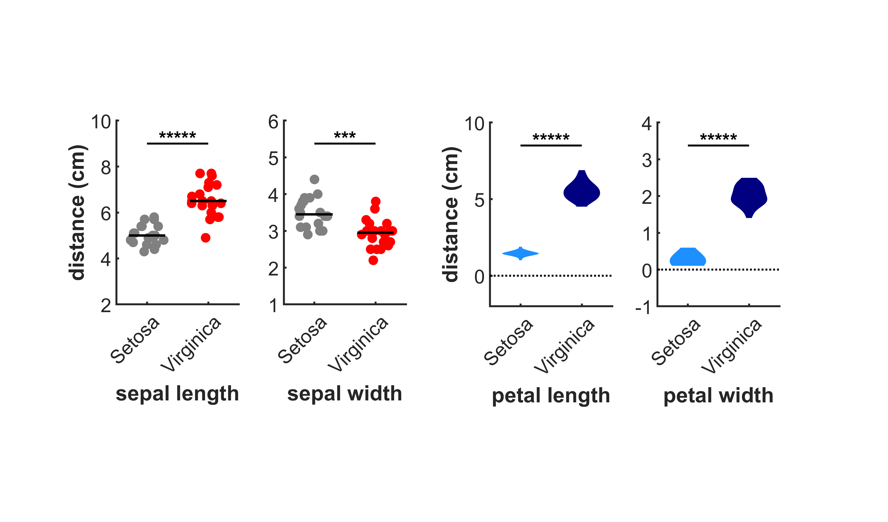

# statTest
Script to show significance level from statistical testing on group comparison plots. The Iris dataset ([Anderson, 1935](https://wiki.irises.org/pub/Hist/Info1986SIGNA37/SIGNA_37.pdf); [Anderson, 1936](https://doi.org/10.2307/2394164); [Fisher, 1936](https://doi.org/10.1111/j.1469-1809.1936.tb02137.x)) is used for demonstration. The implementation is compatible with MATLAB R2019b.

Usage:

```matlab
call_statTest()
```  

<p align="center">
    
</p>

### References

1. [Wilkinson, L. (1999). Dot plots. The American Statistician, 53(3), 276-281.](https://www.tandfonline.com/doi/abs/10.1080/00031305.1999.10474474)
1. [Hintze, J. L., & Nelson, R. D. (1998). Violin plots: a box plot-density trace synergism. The American Statistician, 52(2), 181-184.](https://www.tandfonline.com/doi/abs/10.1080/00031305.1998.10480559)
1. [Anderson, E. (1935). The irises of the Gaspe Peninsula. Bulletin of American Iris Society, 59, 2-5.](https://wiki.irises.org/pub/Hist/Info1986SIGNA37/SIGNA_37.pdf)
1. [Anderson, E. (1936). The species problem in Iris. Annals of the Missouri Botanical Garden, 23(3), 457-509.](https://doi.org/10.2307/2394164)
1. [Fisher, R. A. (1936). The use of multiple measurements in taxonomic problems. Annals of eugenics, 7(2), 179-188.](https://doi.org/10.1111/j.1469-1809.1936.tb02137.x)
